# Antler

**Windows · WSL · SSH 의 git 저장소를 한 창에서 살펴보는 가벼운 Git GUI.**
저장소를 바꾸지 않는 읽기 전용 앱이라 어떤 저장소든 안심하고 열어 볼 수 있다.
이름은 사슴뿔(antler)처럼 갈라져 뻗는 git 브랜치 구조에서 따왔다.

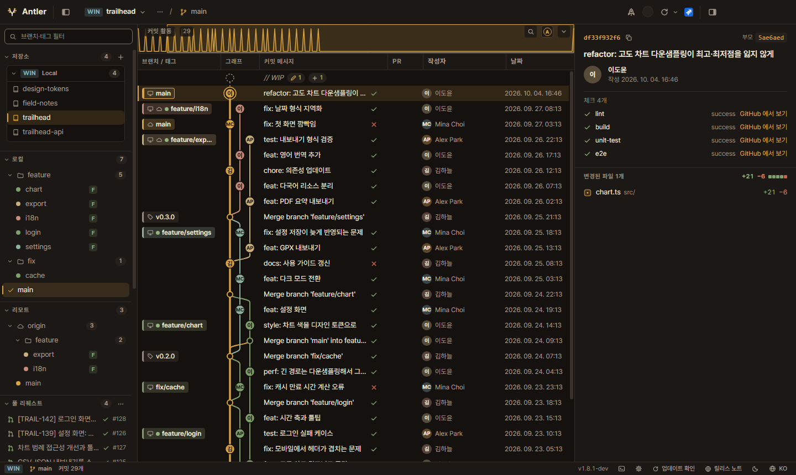

> 스크린샷의 저장소·사람·PR·Jira 이슈는 모두 설명용 가상 데이터다.

## 내려받기

[Releases](https://github.com/Kang-Jacob-GitLB/antler/releases) 에서 OS 에 맞는 설치 파일을 받는다.

| OS | 파일 |
|---|---|
| Windows | `Antler-Setup-<버전>-x64.exe`(설치) 또는 portable exe |
| macOS | dmg (Intel · Apple Silicon) |
| Linux | AppImage · deb |

설치한 뒤에는 앱이 새 버전을 알려 주고, 누르면 업데이트한다([업데이트 방식](docs/updates.md)).
코드 서명이 없어 처음 실행할 때 Windows SmartScreen 이나 macOS Gatekeeper 경고가 뜰 수 있다.

## 한눈에 보기

- **어디에 있든 같은 화면** — 로컬 폴더, WSL 배포판, SSH 원격 서버의 저장소를 한 목록에서 고른다. git 은 각 환경 안에서 돈다.
- **커밋 10만 개도 부드럽게** — Canvas 레인 그래프와 가상 스크롤. 콜드 스타트 약 1.2초, 스크롤 p95 13ms.
- **GitHub · Jira 를 같은 창에서** — PR·이슈·Actions, 여러 저장소를 모은 Launchpad, Jira 칸반·워크로그.
- **저장소를 건드리지 않는다** — commit·push 같은 쓰기 기능이 없다. 자동 fetch 도 원격 추적 ref 만 갱신하고, 악성 저장소 설정을 막는다.
- 다크 · 라이트 · 시스템 테마, 한국어 · English.

## 커밋 그래프

브랜치가 갈라지고 합쳐지는 모양을 레인 그래프로 보여 준다. main 은 늘 같은 색이고, 브랜치는 이름에 따라 색이 정해져
세션이 바뀌어도 같은 브랜치는 같은 색으로 보인다.

- **사이드바**: 로컬·원격 브랜치, 태그, 워크트리, 스태시, 서브모듈, PR·이슈, Actions. 브랜치를 누르면 그래프에서 그 커밋으로 이동하고,
  더블클릭하면 그 브랜치만 보고(solo), 우클릭 메뉴로 숨길 수도 있다.
- **WIP 행**: 맨 위에 아직 커밋하지 않은 변경(수정·추가·충돌 개수)을 보여 준다.
- **커밋 활동 미니맵**: 그래프 위 막대에서 커밋이 몰린 시기를 보고, 누르면 그 시점으로 이동한다.
- **표시 배지**: PR 번호, CI 체크 결과, Git LFS, Gitflow 역할(feature·release·hotfix…).
- **검색**: `Ctrl/Cmd+F` 로 메시지·작성자·해시를 찾고 `Enter` 로 다음 결과로 간다.
- **자동 새로고침**: 터미널이나 다른 도구에서 커밋·브랜치를 바꾸면 그래프가 알아서 다시 읽는다. 보던 커밋 선택은 그대로 둔다.

<details>
<summary>라이트 테마</summary>

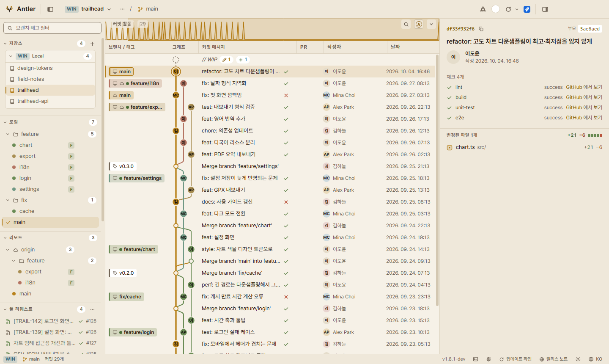

</details>

## diff

변경 파일을 누르면 가운데에 diff 가 열린다. 한 줄(unified) · 나란히(split) 보기, 문법 강조, 줄 안의 바뀐 부분 강조를 지원한다.
`Alt+↑` / `Alt+↓` 로 이전·다음 파일로 넘어가고 `Esc` 로 그래프로 돌아온다. 아주 큰 diff 는 앞부분만 먼저 보여 준다.

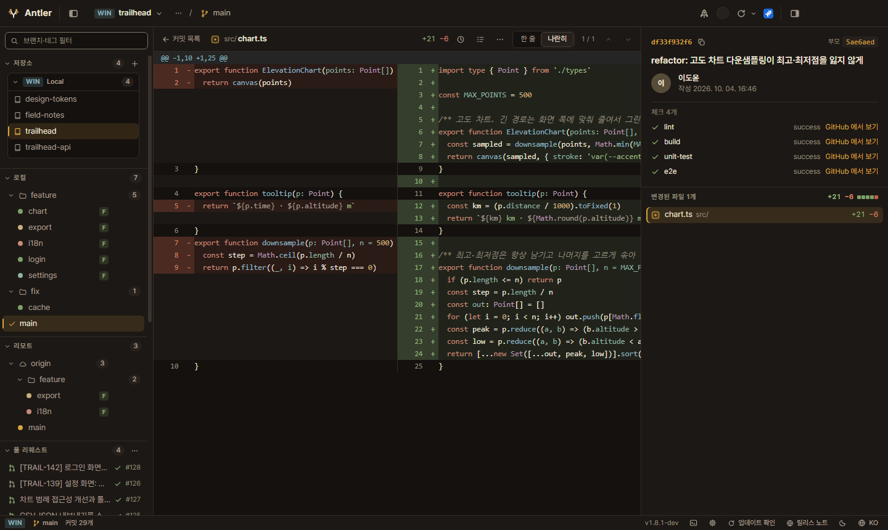

## 코드 탐색기

툴바의 `</>` 버튼(`Ctrl/Cmd+Shift+E`)으로 GitHub 의 Code 탭처럼 저장소 파일을 둘러본다. 커밋 상세나 사이드바의 브랜치·태그 우클릭에서
그 시점의 코드를 열 수 있고, 머리줄에서 브랜치·태그를 바꾼다.

- 폴더를 열면 항목 목록 아래에 그 폴더의 README 가 GitHub 처럼 렌더링된다(표·작업 목록·코드블록 강조·저장소 안 이미지·상대 링크).
- 파일은 문법 강조와 줄 번호로 보고, `.md` 는 미리보기와 코드를 오간다. 이미지는 그림으로, LFS·바이너리는 안내 카드로 보인다.
- **줄 링크**: 줄 번호(또는 `⋯`)를 누르고 `Shift`+클릭·드래그로 범위를 고른 뒤 GitHub permalink(`#L10-L20`)나
  코드블록(경로·줄·커밋 머리말 포함)을 복사한다. 아직 push 하지 않은 커밋이면 알려 준다.

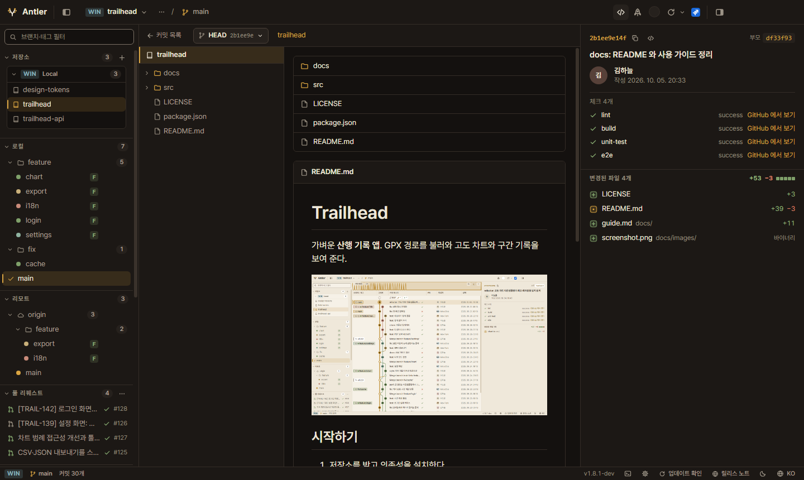

<details>
<summary>줄 범위 선택과 복사 메뉴</summary>

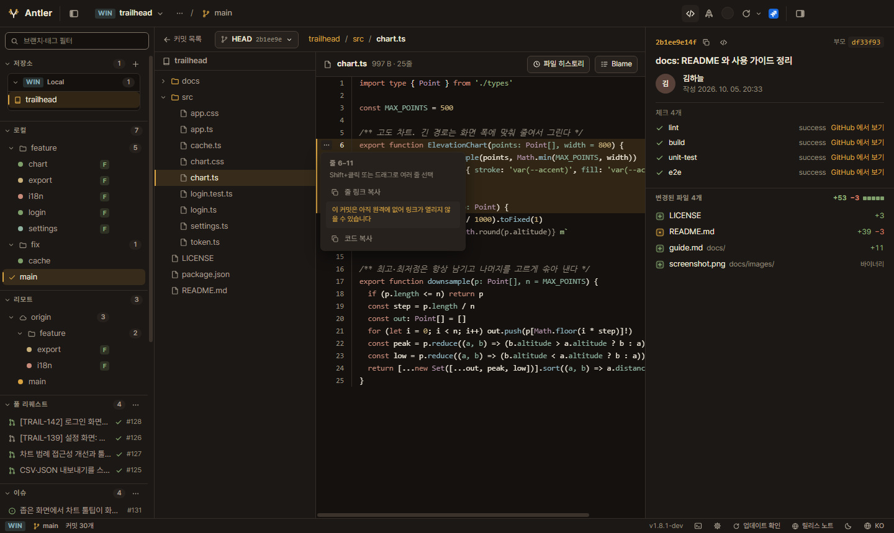

</details>

## 파일 히스토리 · Blame

변경 파일에 마우스를 올리면 나오는 버튼으로 그 파일의 **히스토리**와 **Blame** 을 연다.
히스토리에서 커밋을 고르면 그 시점의 diff 를, "이 시점의 Blame" 으로 그 시점의 줄별 작성자를 볼 수 있다.

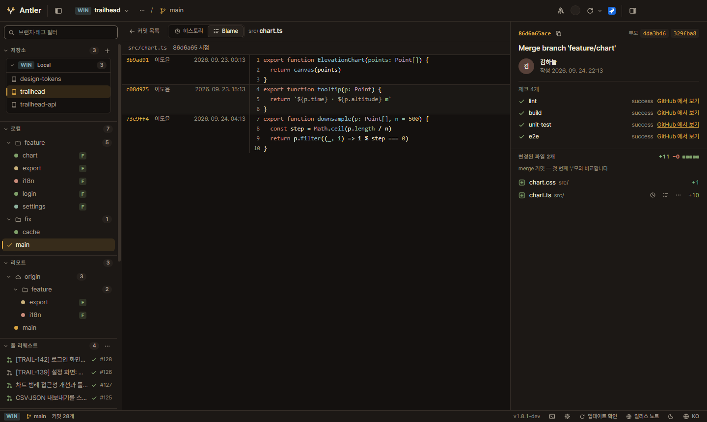

## 두 커밋 비교

커밋 하나를 고른 뒤 다른 커밋을 `Shift`(또는 `Ctrl/Cmd`)+클릭하면 두 커밋 사이에 바뀐 파일을 모아 보여 준다.
사이드바에서 브랜치·태그를 우클릭해 "현재 HEAD 와 비교" 할 수도 있다. 방향을 바꾸거나 `Esc` 로 끝낸다.

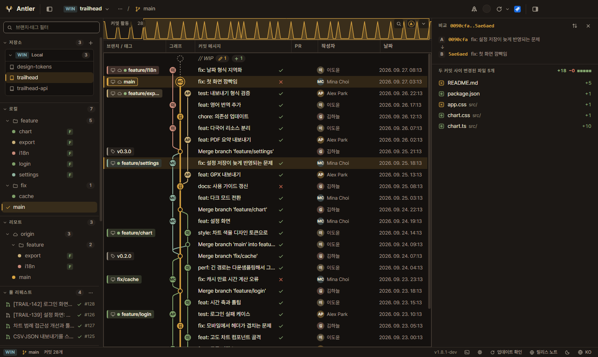

## 명령 팔레트

`Ctrl/Cmd+Shift+P` 로 모든 명령을 검색해 실행한다. 저장소 전환, 테마·언어, 자동 fetch 주기, 외부 도구로 열기 같은 설정도 여기서 바꾼다.
`Ctrl/Cmd+P` 는 저장소 전환, `Ctrl/Cmd+/` 는 단축키 목록이다.

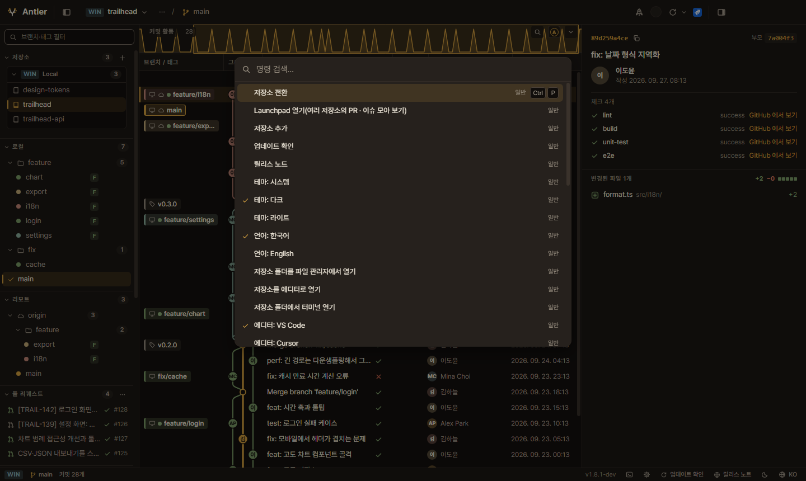

## GitHub PR · 이슈

origin 이 GitHub 저장소면 사이드바에 PR·이슈가 나타난다. PR 은 대화·커밋·변경 파일 탭과 리뷰·CI 상태까지 앱 안에서 본다.
로그인하지 않아도 공개 저장소는 볼 수 있고, PAT · 브라우저 로그인 · GitHub CLI 로그인 가져오기를 지원한다([연결 가이드](docs/connections.md)).

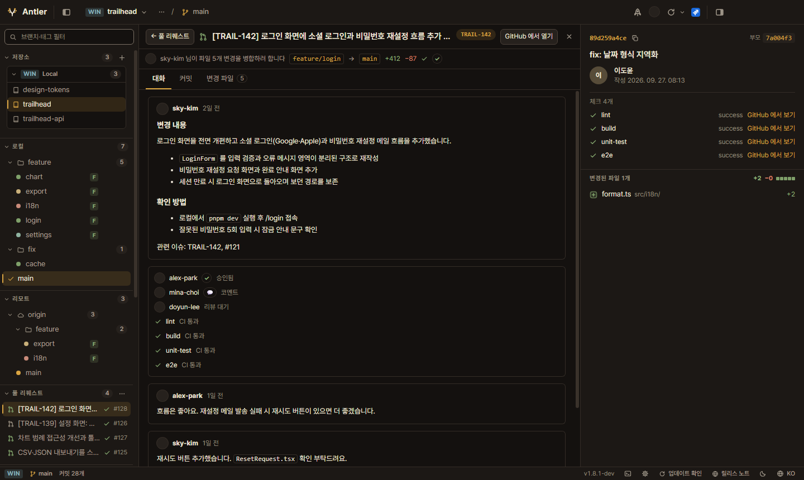

클론하지 않은 GitHub 저장소도 **원격 전용 저장소**로 추가해 이력과 diff 를 볼 수 있다(작업 폴더 없이 앱 캐시에 이력만 받는다).

## Launchpad

여러 저장소에 흩어진 **내 PR · 리뷰 요청 · 할당된 이슈 · Jira 할당 이슈** 를 한 화면에 모은다.
저장소 그룹별로 좁히고, 항목을 고정하거나 잠시 미뤄(스누즈) 둘 수 있다.

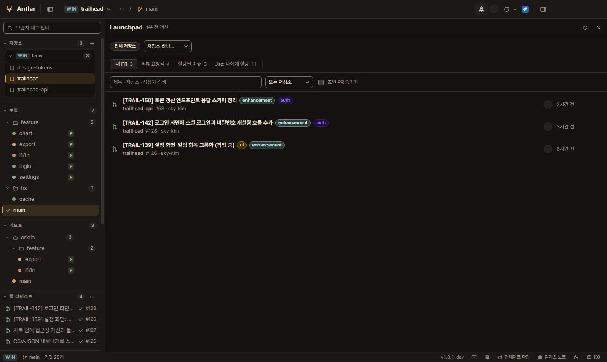

## Jira

툴바의 Jira 버튼으로 창 전체 Jira 작업 공간을 연다. Jira Cloud(API 토큰)와 Data Center / Server(PAT)를 지원한다.

- **나에게 할당 · 저장한 JQL 필터 · 최근 본 이슈** 를 줄 목록이나 칸반으로 본다. 칸반은 에픽과 작업 항목을 나눠 보여 준다.
- **이슈 상세**: 설명·댓글·날짜, 그 이슈를 언급한 커밋·PR(개발 패널), 상태 전환.
- **워크로그**: 일·주·월 캘린더와 사용자별·이슈별 리포트. 팀원을 추가해 함께 보고, 하루 기준 시간이 모자란 날을 강조한다(조회 전용).

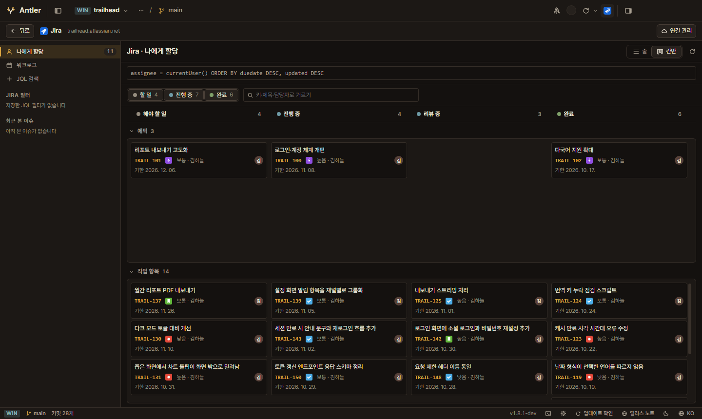

<details>
<summary>이슈 상세 · 워크로그</summary>

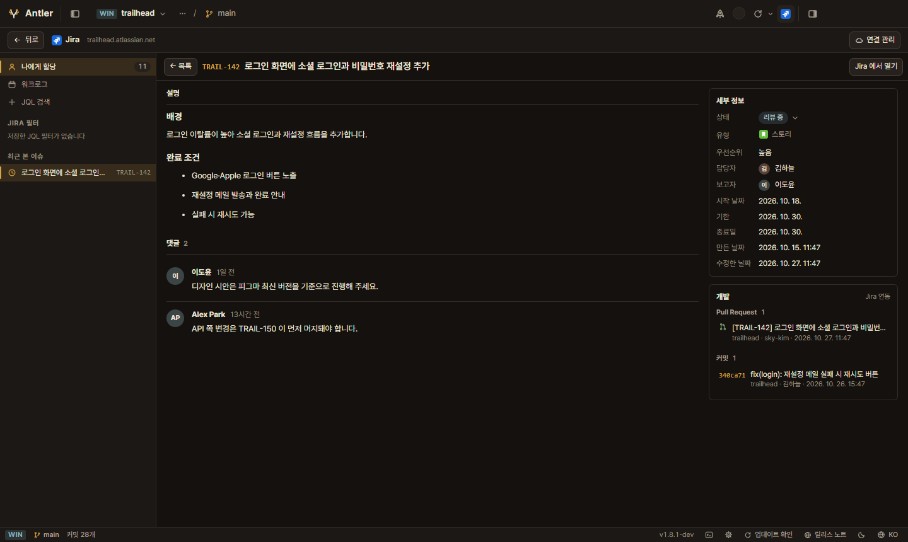

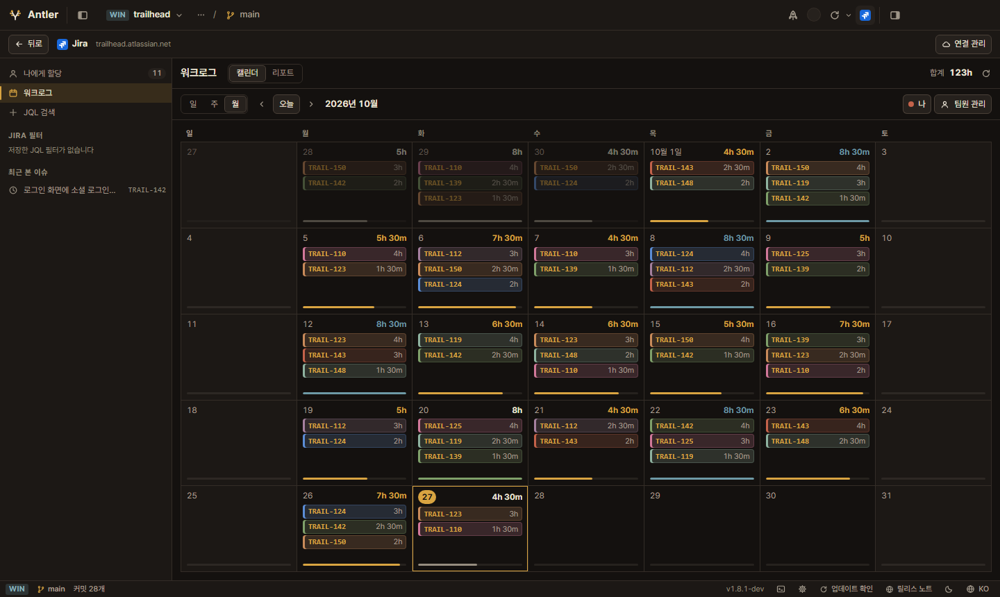

</details>

## 저장소 추가 — 로컬 · WSL · SSH · GitHub

사이드바의 `+` 로 저장소를 추가한다. 저장소가 여럿 든 폴더를 고르면 바로 아래 저장소들을 찾아 골라 담을 수 있고,
원격(WSL·SSH) 폴더도 대화상자 안에서 찾아볼 수 있다. 저장소마다 그룹과 색을 정해 목록을 정리한다.

- **WSL**: 배포판을 고르고 리눅스 경로를 입력한다. `\\wsl.localhost\…` 경로도 알아서 WSL 저장소로 바꾼다.
- **SSH**: `~/.ssh/config` 의 Host 를 그대로 쓴다. 인증은 키 파일·ssh-agent 만 쓰며 비밀번호는 묻지도 저장하지도 않는다.
- **GitHub**: 내가 접근할 수 있는 저장소 목록에서 골라 클론 없이 추가한다.

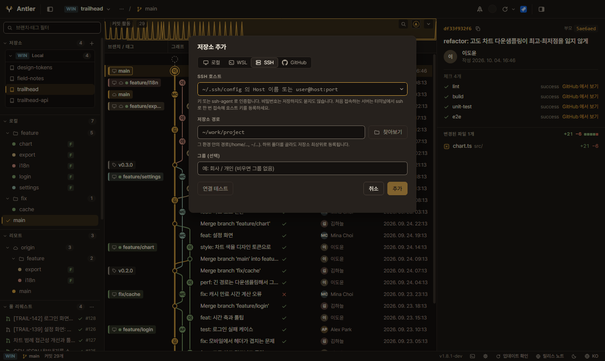

저장소·파일은 파일 관리자, 에디터(VS Code · Cursor · JetBrains · 사용자 지정), 터미널로 바로 열 수 있다.

## 단축키

| 키 | 동작 |
|---|---|
| `Ctrl/Cmd+Shift+P` | 명령 팔레트 |
| `Ctrl/Cmd+P` | 저장소 전환 |
| `Ctrl/Cmd+Shift+E` | 코드 탐색기 열기·닫기 |
| `Ctrl/Cmd+/` | 단축키 목록 |
| `Ctrl/Cmd+F` | 커밋 검색 (`Enter` / `Shift+Enter` 다음·이전) |
| `↑` `↓` `PageUp` `PageDown` `Home` `End` | 커밋 이동 |
| `Alt+↑` / `Alt+↓` | diff 에서 이전·다음 파일 |
| `Ctrl/Cmd+B` / `Ctrl/Cmd+Alt+B` | 사이드바 / 상세 패널 토글 |
| `Esc` · 마우스 뒤로 | 한 단계 뒤로(diff·비교·파일 보기·Launchpad·Jira 닫기) |

macOS 에서는 `Ctrl` 이 `⌘`, `Alt` 가 `⌥` 다.

## 문서

| 문서 | 내용 |
|---|---|
| [docs/build.md](docs/build.md) | 소스에서 실행·빌드·패키징, 릴리스 CI, 개발 도구 스크립트 |
| [docs/architecture.md](docs/architecture.md) | 프로젝트 구조, 핵심 설계, 성능 측정, 의존성 |
| [docs/security.md](docs/security.md) | 보안 설계 — 악성 저장소 방어, fetch 가드, 토큰 보관 |
| [docs/connections.md](docs/connections.md) | GitHub · Jira 로그인, WSL · SSH 설정 |
| [docs/updates.md](docs/updates.md) | 앱 업데이트 방식과 다운로드 검증 |

소스에서 바로 실행하려면(Node 22+, pnpm 10+, 각 환경 안에 git 2.36+):

```bash
pnpm install
pnpm dev
```

## 알려진 한계

- 저장소 쓰기 작업(commit · push · merge 등)은 없다. 예외는 원격 추적 ref 를 갱신하는 `git fetch` 하나다.
- GitHub Enterprise · GitLab · Bitbucket 은 지원하지 않는다.
- SSH 원격의 로그인 셸이 cmd/PowerShell 이면 지원하지 않는다.
- 코드 서명이 없다(Windows SmartScreen, macOS Gatekeeper 경고).
- macOS · Linux 패키지는 개발 환경에서 직접 검증하지 못했다.

## 라이선스

앱 자체의 라이선스는 아직 정하지 않았다(LICENSE 파일 없음). 번들 폰트는 SIL OFL 1.1 이다.

- Pretendard — OFL 1.1
- Nanum Gothic Coding — OFL 1.1

라이선스 고지는 `resources/licenses/`(Pretendard·나눔고딕코딩 폰트, 번들 라이브러리 `THIRD_PARTY_NOTICES.txt`)에 있고, 패키지에는 `resources/licenses/` 로 동봉된다. ssh2 와 그 의존 패키지는 `app.asar` 의 node_modules 에 각자의 LICENSE 와 함께 실린다.
